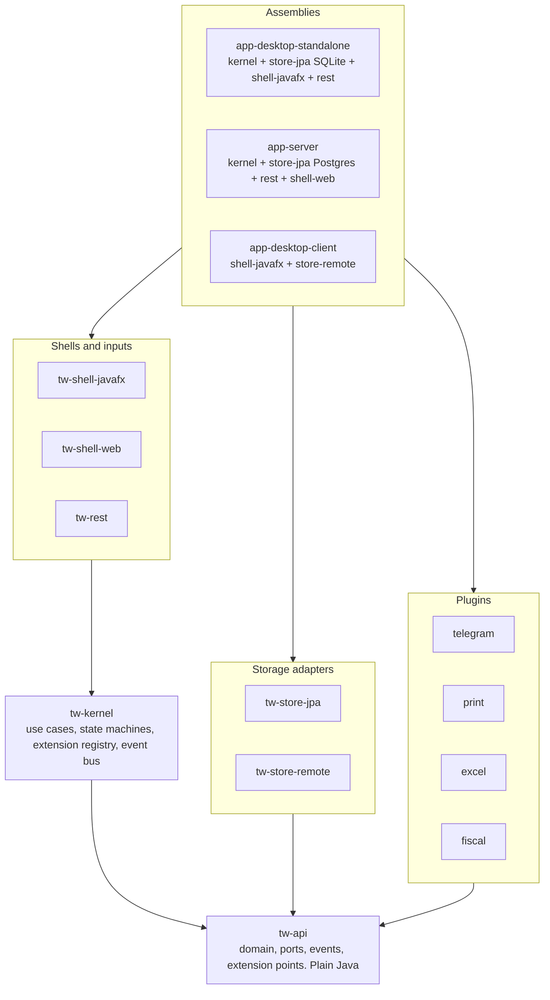

# Extension architecture

Status: **proposal**. The owner likes the idea of assembling both the desktop and the web app from plugins with different adapters. This note describes how to do that cheaply. The decision itself is [ADR 0004](../adr/0004-build-time-plugin-composition.md).

## Two meanings of "plugin"

1. **Build-time composition.** An application is the kernel plus a set of modules and adapters chosen in Gradle. Desktop and web are different combinations. Modules are picked up through Spring Boot auto-configuration and switched with properties. Cheap, reliable, debuggable like normal code.
2. **Runtime plugins.** A jar dropped into `plugins/` is loaded without a rebuild (PF4J, separate class loaders). Needed only when third parties write plugins. Costs: class-loader isolation, version compatibility, updates.

**Proposal:** build-time composition now, with the extension API in plain Java (no Spring types), so runtime loading can be added later without rewriting plugins.

## Layers

Everything depends only on layers below it. Plugins see only `tw-api`; this is enforced by Gradle dependencies and an ArchUnit test. Desktop and web differ only in the set of adapters. In a thin desktop client, `tw-store-remote` implements the same DAO ports over HTTP, so the UI does not know where the data lives.

Mapping from the current modules: `tw-core` becomes the base of `tw-api`, `tw-workflow` becomes `tw-kernel`, `tw-persistence-api` becomes `tw-store-jpa` together with the missing adapters, `tw-fx-javafx-starter` becomes `tw-shell-javafx`. The main mistake of the current layout is `tw-fx-plugin-api`: the plugin API must not depend on JavaFX.

## Extension points

**Behaviour, through domain events.** `OrderStatusChanged`, `WorkItemFinished`, `PaymentReceived` and so on; a plugin subscribes, for example Telegram sends "your bike is ready". A `TransitionGuard` lets a plugin veto a transition, for example the fiscal plugin blocks "Handed over" until the receipt is printed. Side effects run after commit (`@TransactionalEventListener(AFTER_COMMIT)`); reliable notifications will later need an outbox.

**Integrations, through provider interfaces.** `NotificationChannel`, `DocumentTemplate` (receipt, tag, invoice), `ExportFormat`, `ImportSource`, `FiscalRegister`, `PriceRule`. The kernel collects all beans of these types and offers them in the UI.

**UI, through declarative contributions.** Simple contributions are described with a neutral model (i18n key, icon, permission, command or form schema) and each shell renders them itself: `nav.item`, `order.tab`, `toolbar.action`, `context.action`, `dashboard.block`, `statusbar.item`. These slots already exist in the UI design v1. Complex screens stay separate modules per shell, for example `tw-plugin-reports-javafx` and `tw-plugin-reports-web`.

**Plugin descriptor.** `TwisterPlugin { id, version, requires, settingsSchema, migrations }`. Every plugin owns its tables and Flyway migrations in its own location and references core tables by id only.

## Tablets over Wi-Fi

The desktop app already runs Spring Boot, so it has an embedded web server. The same process on the workshop PC can serve REST and a light mobile web UI on the local network. See [ADR 0006](../adr/0006-desktop-hosts-lan-server.md).

- **Pairing:** the mechanic scans a QR code on the PC screen with the address and a device token. Then everything works in a normal browser, nothing to install.
- **Updates:** changes from the tablet ("started", "done", "added part") appear at the front desk at once through WebSocket.
- **Photos:** taken in the browser at intake.

Things to watch:

- Find the PC by mDNS (`twister.local`) or by the IP in the QR code.
- The installer must add a Windows Firewall rule.
- Guest Wi-Fi often isolates devices from each other.
- PWA install and offline mode need HTTPS, which is painful on a LAN; a plain browser over HTTP still works with the camera.
- If the PC is off, the tablet does not work.

## Risks

- **Web UI technology.** With a React SPA, plugin UI contributions need module federation. With server-side rendering (Thymeleaf + htmx, or Vaadin) declarative contributions render easily.
- **Two-database sync** is the most expensive option. Prefer one source of truth: either a standalone desktop with its own database, or a thin client to a server.
- **Premature generality.** Lay down the layers, `tw-api` and the plugin descriptor now; add concrete extension points only when a real plugin needs them. First candidates: printing, Telegram, Excel.

## Diagrams

- [C4 level 1: system context](../diagrams/c4-1-context.mmd)
- [C4 level 2: containers](../diagrams/c4-2-containers.mmd)
- [C4 level 3: desktop components](../diagrams/c4-3-desktop-components.mmd)
- Sequences: [intake](../diagrams/seq-1-bike-intake.mmd), [tablet pairing](../diagrams/seq-2-tablet-pairing.mmd), [finish a job](../diagrams/seq-3-finish-job-from-tablet.mmd), [estimate approval](../diagrams/seq-4-estimate-approval.mmd), [handover and payment](../diagrams/seq-5-handover-and-payment.mmd)
